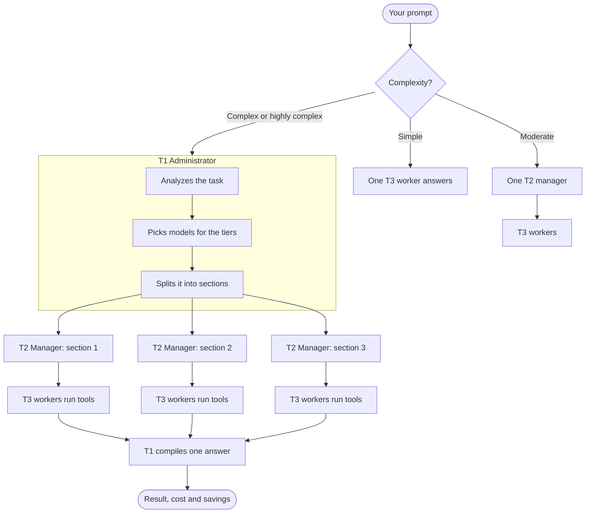

# ◈ Cascade AI

> **One prompt becomes an organization of AI agents that plan, delegate and work in parallel,** each step routed to the best-value model for the job. Typically far cheaper than running everything on one frontier model, and Cascade shows you the saving on every run.

[](https://www.npmjs.com/package/cascade-ai)
[](https://doi.org/10.5281/zenodo.23427428)
[](LICENSE)
[](#install-and-quick-start)
[](#providers-and-your-own-keys)
[](CONTRIBUTING.md)

<p align="center">
  
</p>

Cascade runs your request through a three-tier team of agents: **T1 plans, T2 manages, T3 does the work**. It sizes the team to the task, picks a model for each agent, runs tools (shell, files, git, web, browser, documents, images), checks the results and hands you one finished answer. Think Claude Code or Gemini CLI, but built around **orchestration**: you can see the team work, steer it, and see what it saved you.

```bash
npm install -g cascade-ai
cascade "Refactor the auth module to use JWT, add tests, and open a PR"
```

**Links:** [cascadeai.in](https://cascadeai.in) (web app) · [Docs](https://cascadeai.in/docs) · [Download the desktop app](https://cascadeai.in/download) · [npm](https://www.npmjs.com/package/cascade-ai) · [Changelog](CHANGELOG.md) · [Contributing](CONTRIBUTING.md)

### What's new (v0.99)

- **Workspaces.** A Cascade Cloud run can now work in a **folder on your own computer**, through the desktop app. Its models stay on the server; its shell, file and git calls run on your machine, after you say yes there. The folder's path never leaves your computer. [Details](#workspaces-a-cloud-run-in-your-own-folder)
- **Choose where a chat works** from the message box in the web app, and see "Files changed in your workspace" with diffs.
- **Thinking levels.** Pick Auto, Off, Low, Medium or High per run in the web and desktop apps (`thinking` in config for the CLI and SDK).
- **Shared run memory.** Workers on one run share a board of facts about your machine and reuse each other's read-only command results, and a worker is told when a file it read has changed.
- **Real pictures in reports.** `find_image` and `annotate_image` are free and used before generated images.
- **Auto mode that asks only about what can't be undone**, and a checkpoint for every run so `/undo` can take it back.
- **Memories and skills built from your chats**, a **live model leaderboard**, **free web search with no key**, **your own Chrome as the agent's browser**, an **OpenAI-compatible `/v1` API**, and **one-command self-hosting**.

[CHANGELOG.md](CHANGELOG.md) has every release.

---

## Table of contents

- [Surfaces: where you can use it](#surfaces-where-you-can-use-it)
- [How it works](#how-it-works)
- [Install and quick start](#install-and-quick-start)
- [Features in depth](#features-in-depth)
  - [Providers and your own keys](#providers-and-your-own-keys)
  - [Local models](#local-models-ollama-and-openai-compatible-endpoints)
  - [Web search](#web-search)
  - [Attachments](#attachments)
  - [File generation](#file-generation)
  - [Images](#images)
  - [Memories](#memories)
  - [Skills](#skills)
  - [Connectors and MCP](#connectors-and-mcp)
  - [Spend tracking and budgets](#spend-tracking-and-budgets)
  - [Conversation branches](#conversation-branches)
  - [The live model leaderboard](#the-live-model-leaderboard)
  - [Workspaces](#workspaces-a-cloud-run-in-your-own-folder)
  - [Browser relay](#browser-relay-your-own-chrome)
  - [Checkpoints, `/undo` and `/checkpoints`](#checkpoints-undo-and-checkpoints)
  - [Auto mode and approvals](#auto-mode-and-approvals)
  - [Privacy paths and the process jail](#privacy-paths-and-the-process-jail)
  - [The desktop app](#the-desktop-app)
  - [Tools reference](#tools-reference)
- [OpenAI-compatible API](#openai-compatible-api)
- [CLI quick reference](#cli-quick-reference)
- [Configuration](#configuration)
- [SDK](#sdk)
- [Self-hosting](#self-hosting)
- [Privacy and security](#privacy-and-security)
- [Development](#development)
- [License](#license)

---

## Surfaces: where you can use it

All surfaces share one Cascade account. Settings can follow you between them through opt-in, end-to-end-encrypted sync (see [Providers](#providers-and-your-own-keys)).

| Surface | What it is | Get it | Docs |
|---|---|---|---|
| **Web app** | Hosted chat at [cascadeai.in](https://cascadeai.in): bring your own keys, files, memories, skills, connectors, spend report, your own Chrome as a browser, workspaces. | Sign in with GitHub or Google | [docs](https://cascadeai.in/docs) |
| **Desktop app** | Chat, a live **Cockpit** of the agent tree, a code editor with terminal, an in-app browser, and the bridge that lets cloud runs use your folders and browser. | [cascadeai.in/download](https://cascadeai.in/download) | [docs](https://cascadeai.in/docs) |
| **CLI** | Interactive REPL and one-shot runs in your terminal. | `npm install -g cascade-ai` | [docs](https://cascadeai.in/docs/cli) |
| **SDK** | `runCascade()`, `createCascade()`, `streamCascade()` from Node. | `import … from 'cascade-ai'` | [SDK](#sdk) |
| **OpenAI-compatible API** | `POST /v1/chat/completions` and `GET /v1/models` so any OpenAI SDK can call Cascade. | Your Cascade server | [below](#openai-compatible-api) |
| **Self-host** | The web app and API on your own machine or server. | `docker compose up` | [Self-hosting](#self-hosting) |

Which one should I use? The **web app** is the quickest start. The **desktop app** adds your own files and tools on your own machine. The **CLI** is for terminal work and scripts. **Self-host** if you want to run the server yourself.

---

## How it works

Every prompt is graded for complexity first (cheap rules first, then a classifier). Only the tiers the work needs are started.



| Complexity | Tiers in play | Shape |
|---|---|---|
| Simple | T3 | One worker answers directly. Small talk gets a direct answer with no worker at all. |
| Moderate | T2 → T3 | One manager and its workers, no planner. |
| Complex | T1 → T2 → T3 | T1 plans 3–5 sections, one T2 manager each. |
| Highly complex | T1 → T2 → T3 | 5 or more sections. |

- **T1 Administrator** plans, chooses models and writes the final answer. It uses a frontier-class model.
- **T2 Manager** owns one section, breaks it into subtasks, spawns workers and checks their work. It uses a mid-size model.
- **T3 Worker** runs the tools and tests its own output. It uses small, fast (often local) models. A worker can ask its manager for bounded sibling workers when work fans out.
- **Permission escalation.** A worker that needs more than it has asks up the chain: T3 → T2 → T1 → you.

### Routing: the best-value model for each step

Set a tier to **Auto** (the default) and Cascade picks within that tier's class of model for each task. It combines live public benchmark scores for the task type with live pricing, then learns from how each model actually did. `autoBias` (`balanced`, `quality` or `cost`) sets the trade-off. Newly released models compete as soon as a provider lists them. You can pin any tier to a model instead. If a model fails, **failover** treats a rate limit, an exhausted quota, a model your key can't use and a dead account differently.

`cascade stats` shows what the router has learned, and `/rate good|bad` teaches it.

### "Why?" and cost savings

Every run can explain itself: the complexity verdict and the classifier's reasoning, which model served each tier, any failovers and escalations. Use `/why` in the CLI, the **Why** panel in the desktop app, or **Why** from the web app's top bar.

Every run also shows what the hierarchy **saved** versus running the whole thing on the top tier (for example `saved $0.094 – 75% vs. all-T1`), because the cheap T3 workers (free, when local) do the heavy lifting. Where a model has no published price, Cascade says "cost not tracked" instead of showing $0.

### Thinking levels

Choose how much each model thinks: **Auto**, **Off**, **Low**, **Medium** or **High**. Each provider gets the setting in the form its models take (Claude adaptive thinking and effort, OpenAI reasoning effort, Gemini thinking level or budget). Azure deployments, Ollama and OpenAI-compatible endpoints are never sent it. Where a model can't turn thinking off, "Off" means the least it does. Set it in the composer in the web and desktop apps, or with `thinking` in config.

### Shared run memory and the board

Workers on one run share a board so they don't each pay to find out the same thing:

- **Facts about your machine** learned from commands that ran and failed (not a git repository here, a command that isn't installed) are passed to every worker before its next model call, and kept in the project's knowledge so the next run starts out knowing them. A fact that stops being true is taken back out.
- **A read-only command run again** in the same folder reuses the earlier answer (for a minute at most, or until something changes). Commands whose answer moves by itself (`date`, `ps`) and all `git` commands are never reused.
- **A worker is told when a file it read has changed** (by another worker, a command or you), and reads it again instead of trusting an old copy. Only paths are shared, never contents.
- Only short facts in Cascade's own words are kept, never what a tool printed, and subtasks under `privacy.paths` local-only rules neither add to the board nor read from it. Turn fact keeping off with `knowledge.factsExtraction`.

### Other ways to steer a run

- **Boardroom plan review** (`planApproval: "always"`): Complex runs pause so you can approve or edit T1's sections, worker counts and estimated cost before anything spawns.
- **Steering** (`/steer`, or the desktop Steer bar): send a correction to running workers.
- **Resume** (`/continue`): pick a run back up after a token budget stop, a crash or Ctrl-C. Finished sections are restored and only the rest is re-planned.
- **Paused sections** ask for your decision on one card: Guide (redo with your notes), Retry or Skip.
- **Asks instead of guessing** (web and self-hosted web): when a request is genuinely ambiguous, Cascade asks one structured question.
- **Verification**: acceptance criteria that can be checked mechanically ("file exists", "contains X") are settled by looking, before a model is asked to grade them.
- **Cancellation**: stop any run mid-flight; every tier halts at the next safe checkpoint and the partial output is kept.

---

## Install and quick start

```bash
npm install -g cascade-ai       # needs Node.js 22.22.2 or newer
cd my-project
cascade init                    # creates CASCADE.md and config
export ANTHROPIC_API_KEY=sk-ant-...   # or OPENAI_API_KEY, GOOGLE_API_KEY, or use Ollama
cascade doctor                  # checks keys, Ollama and config
cascade                         # interactive REPL
cascade run "explain the auth module in this repo"   # one-shot
```

Already use Claude Code, Codex, Gemini CLI or Copilot CLI? `cascade link` shows which credentials Cascade can reuse (see [Configuration](#configuration)).

Prefer no install? Open [cascadeai.in](https://cascadeai.in), or [download the desktop app](https://cascadeai.in/download).

---

## Features in depth

### Providers and your own keys

Cascade is **bring your own keys**: it never resells model access.

| Provider | Notes |
|---|---|
| Anthropic (Claude) | Also gateways reached through `ANTHROPIC_BASE_URL` |
| OpenAI (GPT) | |
| Google Gemini | |
| Azure OpenAI | Any number of deployments, across resources |
| OpenAI-compatible endpoints | OpenRouter, Groq, DeepSeek, xAI, Mistral, Together, Fireworks, llama.cpp, vLLM, LM Studio and more |
| Ollama | Local models |
| **ChatGPT plan** (CLI and desktop only) | Your paid ChatGPT plan through OpenAI's official Sign in with ChatGPT: no API key, and calls show as $0 (tokens are still counted). `cascade chatgpt signin`, or **Continue with ChatGPT** in Settings. |

Models are discovered from each provider, so new releases compete in routing without a Cascade update.

**Your ChatGPT plan (CLI and desktop).** With a paid ChatGPT plan you can run eligible requests on it instead of an API key. `cascade chatgpt signin` opens your browser (OpenAI's own sign-in; Cascade registers its own client and never reads another tool's login). `cascade chatgpt status` shows the account and when its token expires, `accounts` switches between several, `signout` revokes the session, and `export` / `import` move the sign-in to a machine with no browser. The models are the ones your account offers. Plus has a five-hour limit shared with every app you use your plan in; when you reach a limit Cascade tells you and links to *Manage usage* (chatgpt.com/settings/usage), and never switches to another billing path by itself. **Not available in the web app** (hosted apps need OpenAI's commercial partner program, and the sign-in forbids tokens in browser storage). Tokens live in `~/.cascade-ai/chatgpt-accounts.json` (mode 0600), not in the keys file and not in sync.

**Where keys live**

- **Web app:** keys are kept in your browser (the Key Vault) and travel with each run request.
- **CLI and desktop:** keys are stored once per machine in `~/.cascade-ai/credentials.json` (readable only by you) and shared by every project.
- **Self-host:** the operator's `.env` keys serve the OpenAI-compatible API on a single-account instance.

**Encrypted key sync.** Provider keys, web-search keys, MCP servers and preferences can follow you between web, desktop and CLI. You **push and pull by hand** with a passphrase (`cascade sync push|pull`, `/sync` in the REPL, Account sync in the web and desktop apps). The bundle is encrypted on your device (AES-256-GCM, PBKDF2-derived key). The server stores one opaque envelope and cannot read it. The web app carries provider keys and web-search settings only. Details: [docs/key-sync.md](docs/key-sync.md).

### Local models (Ollama and OpenAI-compatible endpoints)

```bash
ollama pull llama3.2:3b         # a good T3 worker
cascade doctor                  # Cascade finds Ollama at localhost:11434
```

- Local models are used when they are all you have, when you pin them, or when a `privacy.paths` rule keeps a folder local-only.
- For an OpenAI-compatible endpoint set `local: true` for your own hardware (calls cost $0) or `local: false` for a hosted one (priced from Cascade's pricing data; a model it can't price shows "cost not tracked"). Unset, Ollama and localhost or LAN endpoints count as local.
- **Text-tool fallback.** A model with no native tool calling, or one whose chat template can't render tools, switches to a text tool format that Cascade parses itself. The switch is remembered for Ollama and OpenAI-compatible servers.
- **Azure:** set `region` in the provider config to select the right price sheet.

```jsonc
{ "providers": [{ "type": "openai-compatible", "baseUrl": "https://api.groq.com/openai/v1",
                  "apiKey": "...", "model": "llama-3.1-70b-versatile", "local": false }] }
```

### Web search

`web_search` and an SSRF-guarded `web_fetch` are built in. With **no key at all**, **Open Web** searches several free sources at once and merges the results, and it recognises bot checks and empty pages rather than reporting "nothing found". For better results add a backend: **SearXNG** (`SEARXNG_URL`), **Brave** (`BRAVE_SEARCH_API_KEY`) or **Tavily** (`TAVILY_API_KEY`); in the web and desktop apps add them in Settings. `web_search` with `read: true` searches and reads in one call, and `web_fetch` returns a page's main content the way a reader would. Turn it on per chat from the composer's Web toggle.

### Attachments

Attach files to a message in the web app (picker, drag and drop, or paste):

- **Images:** JPEG, PNG, GIF or WebP, up to 5 MB each. Vision-capable models see them; T1 reads them as part of your request, and a T3 worker reads them when image work is the subtask.
- **Documents:** PDF, Word (`.docx`) or text files (txt, md, csv, json and so on). They are turned into text on upload and added to the run's context. The size limit depends on your plan (5 MB on Free, 10 MB on Pro).
- The desktop chat takes images and documents too.

### File generation

Cascade produces **real files**, not text saved under the wrong extension.

- `generate_document` renders genuine `.docx`, `.pptx` and `.xlsx` files from Markdown or CSV, with embedded images and real, editable PowerPoint charts from a fenced ` ```chart:bar ` block (body: CSV). Decks can animate. `pdf_create` renders PDFs.
- In the web app, a reply can include **file cards** (` ```file:name.ext ` blocks). **Download** is free (your browser makes the file); **Save to Cascade files** stores it in your account, metered by plan.
- Mermaid diagrams and maths in replies are rendered.

More: [docs/file-generation.md](docs/file-generation.md).

### Images

Reports prefer **real pictures** over generated ones, and the real-picture tools are free:

- **`find_image`** finds a real picture of a real thing (a product, a place, a person) from the page itself or Wikimedia Commons. It is saved with a caption naming its source (site, author, licence), and the report keeps the caption.
- **`annotate_image`** circles, boxes, points to, highlights, labels, numbers or blurs parts of a screenshot or picture and saves a marked copy. On a screenshot, a control can be marked by its ref (`e14`).
- **`browser_control` `capture`** saves a screenshot (or one control) for a report.
- **`generate_image`** (also `generate_speech` and `generate_video`) is for things that don't exist yet, and needs a provider key that supports it.
- `image_analyze` describes images, and `transcribe_audio` turns audio into text.

If a requested picture can't be made, you still get the answer plus a plain note about the missing picture.

### Memories

The web app keeps **memories about you** and brings them into every chat. Open the Memory panel: they are grouped as About you, Preferences, Projects & work, Goals, Instructions and Facts.

- **Add one yourself** under a category. Mark it "True for now" if it will change, such as a current project.
- **Build from my chats** reads chats you choose, with your own providers, after showing the model and an estimated cost. It suggests memories, each backed by a quote of your own words, and **nothing is saved until you keep it**. A suggestion matching a memory you have adds to it instead of duplicating, and earlier wordings are kept in its history. Its cost shows in your spend report, and you can stop it any time.
- Import chats and memories from elsewhere, and delete them whenever you like.

### Skills

A skill is a reusable set of instructions (a persona or way of working) you pick per chat. The web app ships a few presets (such as Code reviewer and Research analyst), and you can create, edit and delete your own. With your own model's help, in the Skills panel:

- **Write it with AI:** describe what it is for and the name, description and instructions are drafted for you to edit.
- **Improve with AI:** say what should change; the proposal appears beside the current text and nothing changes until you accept.
- **Suggest from my chats:** see the cost first; skills are suggested only from tasks that appear in at least two of the chats you choose.

### Connectors and MCP

Cascade is an MCP ([Model Context Protocol](https://modelcontextprotocol.io)) client. Connected servers' tools become available to workers.

- **Web app:** a **Connectors** directory of hosted servers (GitHub, Notion, Linear, Sentry, Atlassian, Stripe and Cloudflare Docs), plus **Custom MCP server** for any remote endpoint. Servers that support **OAuth** sign in with one click (OAuth 2.1 with PKCE; tokens are encrypted at rest and refreshed before runs). GitHub uses a personal access token. Remote servers are https-only with an SSRF guard.
- **CLI:** `cascade mcp connect <url>` runs the OAuth login in your browser; `cascade mcp list`, `cascade mcp remove <name>`. Tokens are stored locally (mode 0600) and refreshed at run time.
- **Desktop:** a Connectors tab in Settings.
- **Local (stdio) servers** go in config under `tools.mcpServers`, and each must also be named in `tools.mcpTrusted` or it won't start.

More: [docs/mcp-oauth.md](docs/mcp-oauth.md), [docs/connectors-broker.md](docs/connectors-broker.md).

### Spend tracking and budgets

- **Spend & savings report** (web app): what your runs cost and saved, by day and period (today, 7 days, 30 days, all time), with a per-tier and per-model breakdown. Only numbers are stored, never prompts or replies. Memory building and skill suggestions show up there too.
- **Live cost** in every surface: tokens, USD and delegation savings per run (`/cost` in the CLI).
- **Per-run caps:** *Max tokens per run* (default 200k) and a *per-run cost cap*. A run plans within its cap, and at 80% starts no new work and writes the answer from what is done, so you still get one.
- **Session and daily caps** (CLI and SDK config): `budget.sessionBudgetUsd`, `budget.dailyBudgetUsd` (`/budget set <$>`, `/budget clear`), with a warning at `budget.warnAtPct` (default 80). `/continue` resumes a run that hit its token cap.
- **Plan limits** on Cascade Cloud: Free is 20 runs a day, Pro 200 (resets at midnight UTC), plus a daily allowance of hosted browser sessions where a deployment offers them.

### Conversation branches

A chat is a **tree**, so you can explore without losing anything. **Edit** a prompt to fork a new branch, **regenerate** a reply to get a sibling answer, and switch between versions with the `‹ n/m ›` navigator. Delete a message with its subtree. Cloud chats are shared across surfaces: signed in, the CLI and desktop app mirror each finished turn into a cloud conversation (opt out with `CASCADE_NO_CLOUD_SYNC=1` in the CLI), and you can manage them from the terminal:

```bash
cascade sessions                              # list your cloud chats
cascade sessions show <id>                    # transcript with branch markers
cascade sessions branch <chat> <message>      # switch to another branch
```

In the REPL, `/branch` forks the local session.

### The live model leaderboard

How each model has actually done on each kind of task across Cascade's runs is public on the landing page ([cascadeai.in](https://cascadeai.in)) and at `GET /api/leaderboard` on a server. It is built from counts in the shared learning pool only, never what a run said or whose it was. The same pool drives Auto routing.

### Workspaces: a Cloud run in your own folder

By default a hosted run has no shell and no files. **Workspaces** let a Cascade Cloud run work in **a folder on your own computer**, served by the desktop app or by the CLI (`cascade workspace serve`). The agent loop stays on the server; only **tool calls** cross (`shell`, `file_read`, `file_write`, `file_edit`, `file_delete`, `file_list`, `glob`, `grep`, `git`, `run_code`). Cascade hosts no cloud sandboxes.

**Set up**

1. Self-hosters: set `WORKSPACE_RELAY=true` on the server. Without it none of the workspace endpoints exist.
2. In the desktop app, sign in to Cascade Cloud and turn on **Settings → Workspaces** (off by default; it uses the same pairing as Cloud runs).
   Or, from a terminal: `cascade login`, `cascade relay pair` once, then `cascade workspace serve [folder]` (see below).
3. In the web app, use the **Environment** button next to the tools in the message box. It lists "Cloud (no files)" (the default) and each of your computers, with a dot for whether it is serving. The choice is remembered per chat.

**What you control, on your computer**

- **Consent.** Nothing runs without a yes in the desktop app, where you pick the folder and the tools the run may have. A whole drive, your home folder or a folder that contains it can't be chosen.
- **Tools presets.** *Read only* (list, read, glob, grep), *Read and edit files* (adds write, edit, delete), or *Everything* (adds shell, git and running code), or any mix. A call for any other tool is refused there, whatever the server sends.
- **Approvals.** Risky calls (deleting, sending things off the machine, rewriting git history, installing software, changing files outside the folder) ask again in the desktop window before they run, with the command shown. Unanswered, they are refused. "Allow everything for this run" is a choice only you can make there.
- **Stop.** A "Serving a Cloud run" banner with a **Stop** button is always visible while a run works. Stop ends its access at once.
- **Undo.** The folder is checkpointed before the run's first change. Afterwards the banner offers **Undo this run's changes**. If no checkpoint can be taken, every change is asked about.
- **Privacy.** `.cascadeignore` and `privacy.paths` are respected: protected and local-only files are never read for the run, since its models are cloud models. Commands run in the [process jail](#privacy-paths-and-the-process-jail).
- **Your path stays private.** The run is told only a label you choose ("Workspace on <computer>", or the folder's name). The server logs none of the files, paths or command output.

**From the CLI**

```bash
cascade relay pair                     # once: register this machine (the same pairing the browser relay uses)
cascade workspace serve                # serve the current folder; or: cascade workspace serve ~/code/app
cascade workspace serve --tools edit --label folder     # default answer: read and edit; the run sees the folder's name
cascade workspace serve --yes-read-only                 # answer "read only" for a run that asks, without a question
cascade workspace status               # paired? registered? which server would it serve?
```

It prints "Serving <label> to Cascade Cloud — Ctrl+C to stop", then asks in the terminal when a run wants the folder: **1** read only, **2** read and edit, **3** everything, Enter for no (no answer within the offer's time, never over ten minutes, is a no), and what the run should call the folder. Risky calls ask again (`y` allow, `a` allow the rest of this run, otherwise no; unanswered for two minutes is no). A compact line per call shows the tool and a relative path or the command, never file contents. **Ctrl+C** ends the run's access at once. When a run ends having changed files, it offers to undo them from the checkpoint; or run `cascade` in that folder and type `/undo`. The folder rules, tool presets, `.cascadeignore`, `privacy.paths` and scrubbing of your configured keys are the same as the desktop app's. `--yes-read-only` is the only automatic answer there is: a risky call is always asked about.

**In the web app**, the chat shows "Waiting for <computer> to allow this run…", then a chip "Working in <folder> on <computer>", a notice while a step waits for your approval on that computer, and a **Files changed in your workspace** list: an edit with a red and green diff, a write with the new content, a delete as "deleted", and a note for any file that changed on your computer since the run read it. Command output and file contents it read are never sent to this list.

More: [docs/design/workspace-env.md](docs/design/workspace-env.md) · [Docs: workspaces](https://cascadeai.in/docs/workspaces)

### Browser relay: your own Chrome

A cloud run can use **a browser on your own machine** instead of one the server hosts. Your device opens one, asks you first, and serves the run a tab. Pick a device kind:

- **Chrome extension.** Build it with `node extension/build.mjs`, load `extension/dist` unpacked at `chrome://extensions`, enter your server address and approve the pairing code. The run gets a new window, **private (incognito) by default** or a normal one.
- **Desktop app:** Settings → Cloud runs makes the app a device (a **Cascade run** window with an empty, in-memory profile).
- **CLI:** `cascade relay pair`, then `cascade relay serve`. Also `cascade relay devices` and `cascade relay forget`.

In the web app, turn on **Browser** in the composer's Tools menu. Settings → Browser lists your devices (up to 10) and chooses where the browser comes from.

What keeps it safe:

- Every run asks first: you type the sites it may use, or tick **Any public site** for research. Your private network (`localhost`, `10.x`, `192.168.x`, `.local`) is blocked.
- **Take over / Hand back:** pause the run to use its tab yourself (to sign in, say), then hand it back. Stop from the toolbar, by closing the window, or with Ctrl-C.
- **Screenshots are off by default.** You must tick "Let Cascade take screenshots of these sites for your report" when you approve, and your device blurs password, card and one-time-code fields.
- Several tabs can run at once (four by default, up to eight), each under the same rules.

The agent reads each page as a **list of its controls with refs** (like `e14`) and acts by ref. `tools.browserVision` sets how much a model sees: `off`, `list` (default), `image` or `marked`. Approvals name the element and the site, and a click on anything labelled pay, buy, delete, send, publish and the like asks every time.

Operators can instead give runs a hosted browser (`REMOTE_BROWSER_*`, a CDP endpoint or Steel) or let users bring their own CDP endpoint (`BROWSER_ENDPOINTS`). The Chrome extension's privacy policy is [extension/PRIVACY.md](extension/PRIVACY.md). Full design and limits: [docs/browser-relay.md](docs/browser-relay.md) · [Docs: browser relay](https://cascadeai.in/docs/browser-relay)

### Checkpoints, `/undo` and `/checkpoints`

Every CLI and desktop run is **checkpointed** before and after, in a git repository of Cascade's own in the project's state folder. **Your own git is never touched.**

- `/undo` puts back the files the last run changed and removes the ones it made. `/undo 3` takes back three runs.
- A file you changed by hand since is left alone unless you add `--force`.
- `/checkpoints` lists runs. The last 50 are kept.
- Files your `.gitignore` leaves out aren't recorded.
- `/rollback` undoes every file the file tools changed in this session.

### Auto mode and approvals

Dangerous tools ask for approval before they run (`tools.requireApprovalFor`, default `shell`, `file_write`, `file_delete`). **Auto mode** (`/auto on|off|status`) works on its own and judges each call by what it does, not by which tool it uses. Reading, and changes a checkpoint can put back (editing project files, running tests and builds, commits), go ahead. It stops to ask before:

- deleting files;
- sending anything off the computer (push, publish, deploy, POST, email);
- rewriting or discarding git history;
- installs and system changes (packages, sudo, services, scheduled tasks);
- writing outside the project;
- destroying database data;
- stopping processes or containers;
- changing permissions or ownership;
- commands it can't read before they run (`eval`, `curl | sh`);
- writing a file a checkpoint doesn't record.

The question says who asks, exactly what, why, and whether `/undo` can take it back. Budget caps remain the hard stop.

### Privacy paths and the process jail

**`.cascadeignore`** (`.gitignore` syntax) lists files agents cannot read or change. Secrets (`.env`, `.env.*`, `*.pem`, `*.key`, `id_rsa`, `id_ed25519`) are always protected. Agents can read `.cascadeignore` but not change it. Cascade's own files live outside your project, where no file tool reaches.

**`privacy.paths`** marks folders `local-only`. A worker whose job names a matching path runs on a private model from the start (one whose endpoint is on your machine or private network). One that reads such a file on the way moves to a private model before the content reaches any model, or is refused if none is configured. Its output is withheld from the tiers above, its approvals come to you, tools that send data elsewhere (web, browser, GitHub, media, MCP, plugins) are refused to it, and what it makes goes to a private folder outside the project.

```jsonc
"privacy": { "paths": [{ "pattern": "secrets/**", "policy": "local-only" }] }
```

**Process jail.** `shell`, `run_code` and `git` run in **bubblewrap on Linux** where it works, with provider keys, Cascade's own files and common credential locations (`~/.ssh`, `~/.aws`, `~/.kube` and the like) hidden from them. Where no supported jailer exists (Windows, macOS, or Linux without bubblewrap), `shell` and `run_code` are refused rather than run unprotected, and the `git` tool uses its own checks. `tools.processJail` can be `auto`, `bwrap` or `off`. Agent-written tools always run in a confined sandbox (an `isolated-vm` isolate, or a WebAssembly sandbox that ships with Cascade) with no filesystem, network or processes.

### The desktop app

Download from [cascadeai.in/download](https://cascadeai.in/download). Highlights:

- **Cockpit:** the live agent graph. Click a node to inspect its output, model, thinking and peer messages. Tool-approval modal, tier override, boardroom plan review, escalation cards for paused sections.
- **Code view:** a Monaco editor with file tree and an integrated **terminal**. Previews open images (PNG, JPG, GIF, WebP, SVG, BMP, ICO, AVIF), PDFs (built-in viewer), audio and video; other binaries offer "Open in default app" and "Show in folder". Previews are read-only.
- **Comms panel:** a live feed of worker-to-worker messages, broadcasts, file locks and your steering injections.
- **Why panel** and a **Models used** section; **diff review** with per-file revert of what a session changed; **Steer bar**.
- **Command palette** (Ctrl/Cmd+K) to jump to any view, action or past session.
- **A browser inside the app** the agent can drive, with live view, take over and hand back, and `read_current_page` for the page you have open.
- **Cloud runs on this computer:** Settings → Cloud runs (browser device) and Settings → Workspaces (folder serving), with a Stop button and an Undo banner.
- **Continue elsewhere:** open a chat from the web or hand one off between web and desktop; cloud-backed sessions with branch navigation.
- A **Thinking** setting, multi-deployment Azure settings, live model lists per provider, and downloads that detect your platform and architecture.

### Tools reference

Workers use these tools (MCP servers' tools, plugins and tools the agent writes for itself join at runtime). Tools marked ✓ are dangerous and need approval unless disabled.

| Tool | What it does | |
|---|---|---|
| `shell` | Shell commands (allowlist and blocklist) | ✓ |
| `run_code` | Run Python or Node code | ✓ |
| `file_read` · `file_list` | Read a file (optional line range); list a directory | |
| `file_write` · `file_edit` · `file_delete` | Write, exact-string edit, delete | ✓ |
| `glob` · `grep` | Find files by pattern; search contents | |
| `code_search` | Search a local code index. Opt in with `"codeIndex": { "enabled": true }` and run `cascade index` | |
| `git` · `github` | git status, diff, commit, push and more; open PRs, list and comment on issues (GitHub / GitLab) | ✓ |
| `web_search` · `web_fetch` | Search the web; fetch a page (SSRF-guarded) | |
| `browser` | Headless Playwright automation (off unless `tools.browserEnabled`) | ✓ |
| `browser_control` | Drive a real browser (desktop app and web), including `capture` for report screenshots | ✓ |
| `read_current_page` | Read the page you have open (desktop app) | |
| `image_analyze` · `find_image` · `annotate_image` | See, find and mark up images | |
| `generate_image` · `generate_speech` · `generate_video` · `transcribe_audio` | Media generation and speech-to-text | |
| `generate_document` · `pdf_create` | Real `.docx`, `.pptx`, `.xlsx` and PDF files | ✓ |
| `knowledge_graph_search` | Query the project's learned facts (appears once there are some) | |
| `peer_message` | Message a sibling worker | |
| `ask_user` | Ask you one structured question (web and self-hosted web) | |

---

## OpenAI-compatible API

Anything that already talks to OpenAI can talk to Cascade. Point the client's `base_url` at your server's `/v1` and use a Cascade access token as the API key. `POST /v1/chat/completions` and `GET /v1/models` work with the official SDKs, streaming or not.

```python
from openai import OpenAI

client = OpenAI(api_key=CASCADE_ACCESS_TOKEN, base_url="http://localhost:8787/v1")
reply = client.chat.completions.create(
    model="cascade",   # a routing mode, not a model
    messages=[{"role": "user", "content": "Compare Postgres and SQLite for a CLI tool."}],
)
print(reply.choices[0].message.content)
print(reply.cascade)   # which tier and model served it, and what routing saved
```

| `model` | What runs |
|---|---|
| `cascade` | Full orchestration, balanced quality against cost |
| `cascade-fast` | One mid-tier model, no orchestration |
| `cascade-quality` | Full orchestration, biased to quality |

- Any other model name returns `404 model_not_found`. Unsupported parameters (`n > 1`, `logprobs`, `tools`, `response_format` and others) are **rejected**, not silently ignored. `temperature` and `max_tokens` are honoured.
- **Provider keys:** on a **single-account** instance (a self-host) the endpoint uses the provider keys in your `.env`. Once a second account exists this stops, so the operator's key never pays for others. Any instance can take keys per request with `extra_body={"providers": [...]}`.
- `/v1` is for server-side clients: browser-side SDKs are deliberately not served. Tools, function calling and image inputs are not part of v1.

---

## CLI quick reference

Run `cascade --help` for everything. Full reference: [Docs: CLI](https://cascadeai.in/docs/cli).

```
cascade [options]                    Start the interactive REPL
cascade run <prompt>                 Run a single prompt and exit
cascade init [path]                  Initialize Cascade in a directory
cascade doctor                       Diagnose API keys, Ollama, config
cascade link [provider]              Reuse credentials from other AI CLIs
cascade models [action] [tier] [v]   List models per tier, or set/unset a tier's model
cascade stats                        What Auto-routing has learned
cascade index [path]                 Build or refresh the code index
cascade export                       Export a session (markdown or json)
cascade identity list|create|set-default
cascade mcp connect <url>|list|remove <name>
cascade login | logout | whoami      Cascade Cloud account (shared with desktop and web)
cascade sync push | pull             Encrypted settings sync, with a passphrase
cascade sessions [show|branch|rm|rename|delete]   Manage cloud chats
cascade relay pair|serve|devices|forget           Serve your browser to cloud runs
cascade workspace serve [folder] | status          Serve a folder to cloud runs, asking here first
cascade dashboard [-p <port>]        Local web dashboard
cascade telemetry [on|off|status]    Anonymous usage telemetry (off by default)
cascade update                       Update to the latest version
```

Options: `-p, --prompt`, `-t, --theme`, `-w, --workspace <path>`, `-i, --identity`, `--alt-screen` (vim-style, flicker-proof; PgUp/PgDn history), `--no-color`, `-v, --version`.

### Slash commands (inside the REPL)

| Command | What it does |
|---|---|
| **Session** | |
| `/help` · `/exit` · `/clear` | Commands, exit, clear the conversation |
| `/sessions` · `/resume <id>` · `/search` | List, resume and search past sessions |
| `/branch` · `/compact` · `/retry` | Fork the session; compress context now; retry the last prompt |
| `/export [markdown\|json]` · `/copy [n]` | Export the session; copy a response |
| `/undo [n] [--force]` · `/checkpoints` · `/rollback` | Take back runs; list checkpoints; undo this session's file changes |
| **Running work** | |
| `/plan <prompt>` · `/replan [guidance]` | Preview a plan; one corrective re-plan |
| `/steer <correction>` | Correct running workers |
| `/auto [on\|off\|status]` | Auto mode |
| `/continue [tokens]` | Resume the last task that hit its token budget |
| `/budget [set <$> \| clear]` | Session budget cap |
| **Seeing inside** | |
| `/status` · `/tree` · `/comms` | Live agent tree; timeline; agent-to-agent feed |
| `/why` · `/cost` | How the last run was routed; cost, tokens and savings |
| `/logs` · `/diagnose` · `/audit` | Runtime logs; setup summary; check the audit log's hash chain |
| **Setup** | |
| `/settings [section \| name value]` | Every setting in one panel (keys are typed masked) |
| `/login` · `/logout` · `/sync push\|pull` | Cloud account and key sync |
| `/model` · `/model-info` · `/models` · `/providers` | Pick models per tier; see what is active and available |
| `/rate good\|bad` | Teach Auto-routing |
| `/config` · `/mcp` · `/identity` · `/theme <name>` | Config summary, MCP servers, identity, theme |

Mouse capture stays off so native select and copy work in your terminal; `/copy` covers grabbing text while output is streaming.

**Themes:** `midnight` (default), `aurora`, `daybreak`, `bloom`, `tide`, `ember`.

**Shell completions** for bash, zsh and fish are in [`completions/`](completions). For example, bash: `source <path-to>/node_modules/cascade-ai/completions/cascade.bash`.

---

## Configuration

Cascade keeps what it knows about a project **outside** the project, in `~/.cascade-ai/projects/<folder name>-<hash>/`: `config.json`, sessions, audit trail, world state, code index and run checkpoints. Provider keys are kept once per machine in `~/.cascade-ai/credentials.json`. The project itself holds only `CASCADE.md` and `.cascadeignore`. `cascade doctor` prints where a project's config is. Prefer the picker over hand-editing: `/model` and `/settings` write the config and apply without a restart.

```jsonc
{
  "providers": [
    { "type": "anthropic" }, { "type": "openai" }, { "type": "gemini" }, { "type": "ollama" }
  ],
  "models": { "t3": "llama3.2:3b" },        // pin a tier; a tier left out stays on Auto
  "autoBias": "balanced",                   // balanced | quality | cost
  "thinking": "auto",                       // auto | off | low | medium | high
  "planApproval": "never",                  // "always" turns on the boardroom
  "budget": { "maxTokensPerRun": 200000, "sessionBudgetUsd": 5, "warnAtPct": 80 },
  "tools": {
    "shellBlocklist": ["sudo rm", "rm -rf", "mkfs"],
    "requireApprovalFor": ["shell", "file_write", "file_delete"],
    "browserVision": "list",
    "mcpServers": [{ "name": "filesystem", "command": "npx", "args": ["-y", "@modelcontextprotocol/server-filesystem", "."] }],
    "mcpTrusted": ["filesystem"]
  },
  "privacy": { "paths": [{ "pattern": "secrets/**", "policy": "local-only" }] },
  "codeIndex": { "enabled": false },
  "dashboard": { "host": "127.0.0.1", "port": 4891, "auth": true },
  "theme": "midnight",
  "altScreen": false
}
```

The file is strict JSON (no comments in the real file). Full reference: [Docs: configuration](https://cascadeai.in/docs/configuration).

- **`CASCADE.md`** in the project root gives agents project-specific instructions (`cascade init` makes a template).
- **`.cascadeignore`**: see [Privacy paths](#privacy-paths-and-the-process-jail).
- **Reuse other CLIs' credentials:** `cascade link` lists what it found; `cascade link anthropic` adopts a key; `cascade link groq` adopts a compatible service with its endpoint. Claude subscription tokens (and other vendors' OAuth logins) are detected but **not usable**: Anthropic doesn't permit third-party use of them.
- **Identities** are named personas with their own system prompts: `cascade identity create reviewer -s "Be strict."`, then `cascade -i reviewer`.

**Environment variables (CLI and SDK)**

| Variable | Purpose |
|---|---|
| `ANTHROPIC_API_KEY` (or gateway `ANTHROPIC_AUTH_TOKEN` + `ANTHROPIC_BASE_URL`) | Anthropic |
| `OPENAI_API_KEY` | OpenAI |
| `GOOGLE_API_KEY` / `GEMINI_API_KEY` | Gemini |
| `AZURE_OPENAI_KEY`, `AZURE_OPENAI_ENDPOINT`, `AZURE_OPENAI_DEPLOYMENT` | Azure OpenAI |
| `OPENROUTER_API_KEY`, `GROQ_API_KEY`, `DEEPSEEK_API_KEY`, `XAI_API_KEY`, `MISTRAL_API_KEY`, `TOGETHER_API_KEY`, `FIREWORKS_API_KEY` | Adopted by `cascade link` with the service's endpoint |
| `SEARXNG_URL`, `BRAVE_SEARCH_API_KEY`, `TAVILY_API_KEY` | Web search backends |
| `CASCADE_DASHBOARD_PASSWORD` (or `_HASH`) | Local dashboard sign-in (no default; sign-in is refused without one) |
| `CASCADE_NO_CLOUD_SYNC=1` | Don't mirror CLI turns into a cloud chat |
| `CASCADE_RELAY_CHROMIUM` | Chromium for `cascade relay serve` |
| `CASCADE_CLOUD_URL` | Cloud server for `cascade login` |

### Local web dashboard

`cascade dashboard` serves a local dashboard at `http://localhost:4891` (bound to `127.0.0.1`): a live ReactFlow agent graph with peer-message edges and a node inspector, a session browser with cost and token stats, a log stream and a config viewer, with JWT auth. Scheduled (cron) tasks run in the dashboard server.

### Hooks

The `hooks` config (`preToolUse`, `postToolUse`, `preTask`, `postTask`) is validated and `HooksRunner` is exported from the SDK, but as far as the code shows runs do **not** call it yet, so these scripts don't fire today. See [docs/ROADMAP.md](docs/ROADMAP.md).

---

## SDK

```typescript
import { runCascade, createCascade, streamCascade } from 'cascade-ai';

const result = await runCascade('Write a Fibonacci function in TypeScript');
console.log(result.output);

await streamCascade('Explain this codebase', (token) => process.stdout.write(token));

const cascade = createCascade({
  providers: [{ type: 'anthropic', apiKey: process.env.ANTHROPIC_API_KEY }],
});
await cascade.init();

const controller = new AbortController();
cascade.on('run:cancelled', ({ taskId, reason, partialOutput }) => console.log(taskId, reason, partialOutput));

const out = await cascade.run({
  prompt: 'Refactor the auth module',
  workspacePath: '/my/project',
  signal: controller.signal,                       // abort() stops all tiers at the next safe point
  approvalCallback: async (req) => { console.log(`Allow ${req.toolName}?`); return true; },
  streamCallback: (chunk) => process.stdout.write(chunk.text),
});
```

An aborted run resolves (not rejects) with the partial output. Connect an MCP server programmatically with `McpClient`. Tools are added by extending `BaseTool` or bundling them as a `ToolPlugin` (see [Development](#development)).

---

## Self-hosting

Run the web app (chat UI, API and socket) on one port with no Cascade account. The default Docker setup uses SQLite and keeps data in a named volume.

```bash
cp .env.example .env
echo "SESSION_SECRET=$(openssl rand -base64 32)" >> .env
echo "CLOUD_DEV_BYPASS=1" >> .env    # local-only sign-in; read the warning below
docker compose up                    # → http://localhost:8787
```

`.env.example` documents every variable the server reads (straight from `cloud/server/src/env.ts`). Build files: [`Dockerfile`](Dockerfile) and [`docker-compose.yml`](docker-compose.yml) for the self-host quick start, [`Dockerfile.cloud`](Dockerfile.cloud) for the production image used on Railway. The full production walkthrough (volume, OAuth apps, domain, smoke test) is [cloud/DEPLOY.md](cloud/DEPLOY.md). Docs: [Self-hosting](https://cascadeai.in/docs/self-hosting).

> **`CLOUD_DEV_BYPASS` is an authentication bypass, not a convenience.** It adds a sign-in that accepts any name with no credential. It ships commented out and `docker-compose.yml` publishes to `127.0.0.1` only. Before exposing the server, set `GITHUB_CLIENT_ID`/`GOOGLE_CLIENT_ID` (and secrets) for real OAuth and remove the bypass.

**Key server settings**

| Variable | What it does |
|---|---|
| `SESSION_SECRET` | Required, at least 16 characters |
| `PORT` (8787), `DATA_DIR`, `WEB_ORIGIN` | Port, where the database and uploads live (mount a volume), and the public origin |
| `GITHUB_CLIENT_ID/SECRET`, `GOOGLE_CLIENT_ID/SECRET` | Real sign-in |
| `WORKSPACE_RELAY=true` | Lets runs work in a folder on a user's computer through the desktop app or `cascade workspace serve`. Off by default; with it off the endpoints do not exist |
| `BROWSER_RELAY=true` | Lets runs use a user's own browser through the extension, CLI or desktop. Off by default |
| `BROWSER_ENDPOINTS=true` | Lets users give runs their own CDP endpoint (public addresses only unless `BROWSER_ENDPOINTS_PRIVATE`) |
| `REMOTE_BROWSER_PROVIDER` (`cdp` or `steel`), `REMOTE_BROWSER_URL`, `REMOTE_BROWSER_API_KEY`, `REMOTE_BROWSER_VISION` | An operator-hosted browser. `HOSTED_BROWSER=off` retires it |
| `MAX_COST_PER_RUN_USD` | Hard per-run cost ceiling (default 0.5) |
| `ANTHROPIC_API_KEY`, `OPENAI_API_KEY`, `GEMINI_API_KEY`, `AZURE_OPENAI_*`, `OPENAI_COMPATIBLE_*`, `OLLAMA_BASE_URL` | Operator keys for the OpenAI-compatible API on a single-account instance |
| `RAZORPAY_*` | Optional billing; disabled until set |
| `CASCADE_DEPLOYMENT_MODE` | `self-hosted` (default) or `hosted` |

---

## Privacy and security

- **Your keys are yours.** Bring-your-own-key only. Synced settings are end-to-end encrypted; the server holds ciphertext it cannot read. On the CLI and desktop, provider keys are written as **plain JSON** to `~/.cascade-ai/credentials.json` (mode `0600`). An encrypted keystore exists in the code but runs don't use it yet.
- **Your files stay yours.** Cascade's own state lives outside your project. `.cascadeignore` protects files from every file and search tool, the code index and symlinked paths. `privacy.paths` keeps sensitive folders on private models.
- **Workspaces and browser relay** work on your device, after you say yes there: nothing runs without it, the folder's path never leaves your computer, and Stop ends access immediately.
- **Containment.** Process jail for `shell`, `run_code` and `git`; SSRF-guarded fetching (checked again at connect time); secret and PII redaction before a worker's output travels up the hierarchy; sandboxed agent-written tools; permission escalation T3 → T2 → T1 → you; a budget kill-switch.
- **Audit log.** Every tool call, file change and agent decision, encrypted and SHA-256 hash-chained; `/audit` checks the chain. It catches an edited or removed entry in the middle, but not a removed tail or a chain recomputed by someone with write access.
- **Telemetry is off by default** (`cascade telemetry`).
- **Reporting a vulnerability:** see [SECURITY.md](SECURITY.md).

More: [Docs: privacy](https://cascadeai.in/docs/privacy) · [Docs: troubleshooting](https://cascadeai.in/docs/troubleshooting)

---

## Development

### Repo layout

```
src/                    The engine, published to npm as `cascade-ai`
  core/                 Tiers (T1/T2/T3), orchestration, router, verification, knowledge, privacy, audit, permissions
  providers/ tools/     Model providers; shell, files, git, web, browser, media, documents
  workspace/            Workspace relay core: protocol, device and executor for cloud runs in your folder
  browser/              Browser leases, remote sessions and the relay
  cli/                  Ink REPL, slash commands, commands, themes
  cloud/ config/ mcp/ memory/ retrieval/ sdk/ …
app/                    Desktop app (Electron + React); app/electron has the workspace and relay code
cloud/server/           Cascade Cloud API, auth, billing, /v1 API, relays, docs
cloud/web/              Cascade Cloud chat UI (React + Vite)
web/                    Local dashboard SPA (ReactFlow)
extension/              Chrome extension for the browser relay
docs/                   Design notes and technical docs
```

### Build, test and lint

Requires Node.js ≥ 22.22.2 and npm.

```bash
git clone https://github.com/Varun-SV/Cascade-AI.git
cd Cascade-AI
npm install              # installs the workspaces too (web, app, cloud/server, cloud/web)
npm run build            # dashboard web + CLI/SDK
npm test                 # vitest
npm run lint             # tsc --noEmit, including the desktop app
```

| Command | What it does |
|---|---|
| `npm run dev` | Watch mode for the CLI |
| `npm run dev:web` · `dev:app` · `dev:cloud` · `dev:cloud-web` | Dashboard, desktop app, Cloud server, Cloud web UI |
| `npm run build:app` | Build the desktop app (after the CLI build) |
| `npm test -w cascade-cloud-server` · `npm test -w cascade-cloud-web` | Cloud server and web tests |

CI ([`.github/workflows/ci.yml`](.github/workflows/ci.yml)) runs lint, tests, the web and CLI build and the desktop build, then the Cloud server typecheck and the server and web tests. Co-locate `*.test.ts` next to the code, and mock external I/O.

To add a tool, extend `BaseTool` in `src/tools/`, register it in `src/tools/registry.ts`, and add it to `DEFAULT_APPROVAL_REQUIRED` in `src/constants.ts` if it needs approval. To bundle tools, use `ToolPlugin`.

### Contributing

Bug reports, docs fixes and features are welcome. Read [CONTRIBUTING.md](CONTRIBUTING.md) first (and open an issue before anything big). For security problems, use [SECURITY.md](SECURITY.md), not a public issue. Planned work is in [docs/ROADMAP.md](docs/ROADMAP.md). To cite Cascade, see [CITATION.cff](CITATION.cff).

---

## License

Cascade AI is released under the [MIT License](LICENSE). Copyright © 2026 Varun SV.
