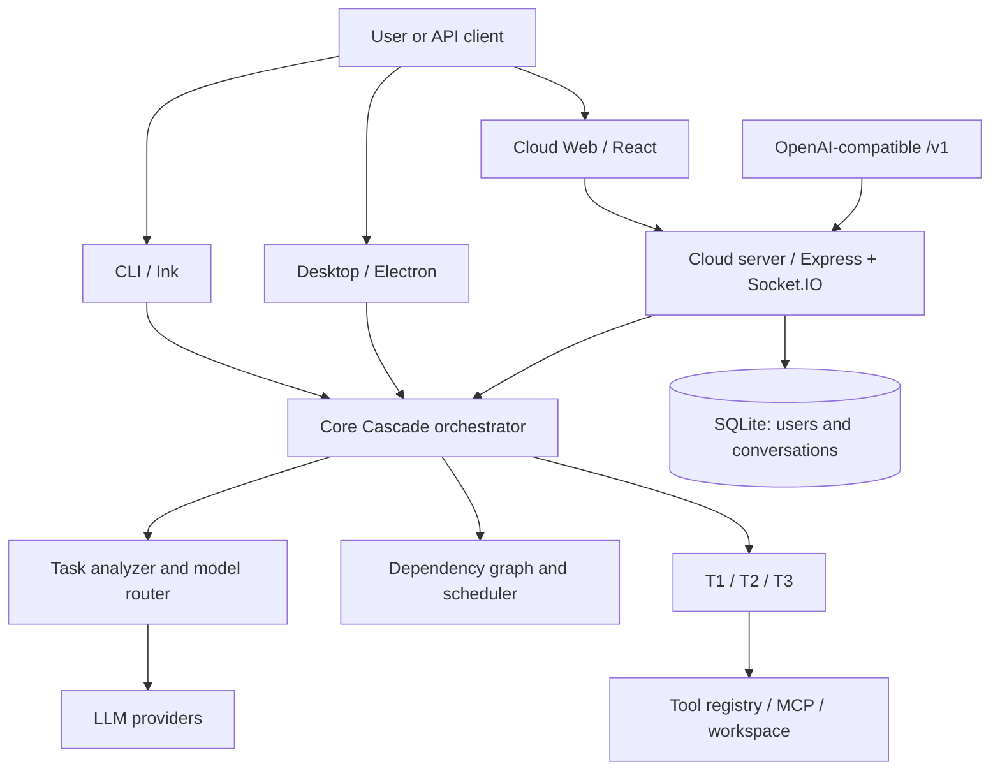

# Architecture

Cascade is a monorepo. The core SDK under `src/` is shared with the CLI, Electron desktop app, and cloud server.

## Code map

| Directory | Responsibility |
| --- | --- |
| `src/core/cascade.ts` | Orchestration facade, event handling, lifecycle |
| `src/core/tiers/` | Administrator, managers, workers, planning, integrity and escalation |
| `src/core/orchestration/` | Typed task graph, scheduler, checkpoints and resume |
| `src/core/router/` | Complexity, model scores, budgets, pricing, feedback and failover |
| `src/providers/` | Anthropic, OpenAI, Gemini, Azure, Ollama and OpenAI-compatible adapters |
| `src/tools/` | Workspace, shell, git, search, browser, media, documents and MCP tools |
| `src/browser/` | Browser leases and remote CDP / Steel plumbing |
| `src/config/` | Zod schema, credential discovery, keystore and config persistence |
| `src/cli/` | Commander commands, Ink REPL, slash commands and themes |
| `src/retrieval/` | Workspace code search / indexing |
| `src/core/documents/` | File rendering shared between Node and browser |
| `app/` | Desktop interface and Electron host |
| `cloud/server/` | API, OAuth, sessions, billing, runs, documents, remote browser, WebSocket |
| `cloud/web/` | Hosted landing/chat/settings/connector interface |
| `web/` | Local dashboard SPA |

## Execution boundaries

A cloud browser request goes through server-side auth, usage checks and browser session management; a desktop browser operates against the desktop host. These are different trust boundaries. Local file/shell tools have access to a selected workspace; hosted file delivery uses deliberately different storage and browser rendering paths. Avoid treating similarly named UI toggles as identical capabilities.

## Core state

- The scheduler uses dependency-aware task graphs and can checkpoint state for continuation.
- The router accounts for provider cost, per-run caps and feedback.
- Cloud uses SQLite for tenant-related persistence and needs a mounted data volume.
- User-specific provider credentials for hosted chat stay client-controlled; opt-in settings sync passes an encrypted envelope through the account server.

Further reading: [[Agent-Orchestration]], [[Security-and-Privacy]], [source architecture](https://github.com/Varun-SV/Cascade-AI/tree/main/src/core).
